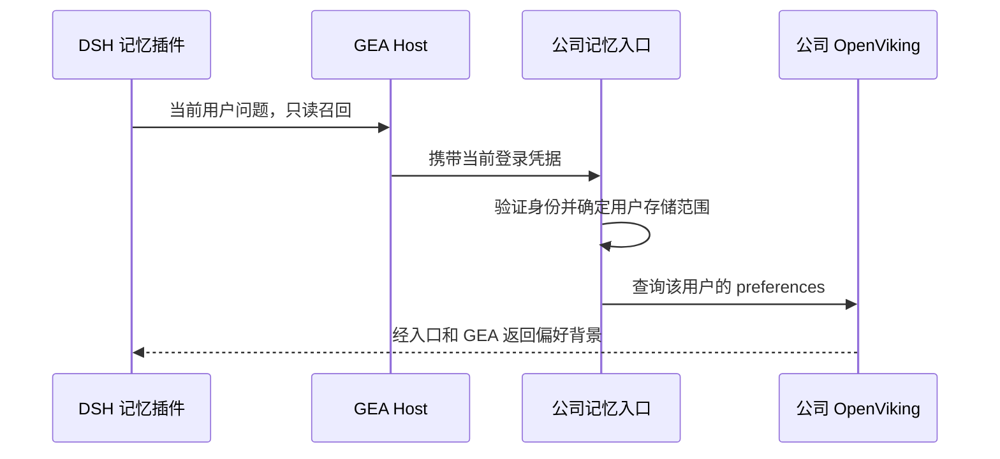

# GEA 个人记忆只读插件

本包独立安装、独立启用，默认关闭。需要带 `geaMemory` Host 能力的 GEA `0.0.183` 和固定 Core `0.2.0-rc.2`。仅安装同版本号的旧 GEA 不能提供这项能力。

普通 bundle 导入本包的 `cordis.patch.yml` 后，在该插件条目的 `config` 显式设置：

```yaml
- id: gea-personal-memory
  config:
    enabled: true
```

GEA Host 由管理员配置公司记忆入口，当前用户需已登录并列入入口白名单。此插件只接受 `enabled` 开关，不配置 token、OpenViking 地址或密钥，也不接受 account/user 归属参数。关闭时设置 `enabled: false`；GEA 登录与身份状态仍由 Host 管理。

插件只在 `agent/pre-step` 对本次原始用户文字召回偏好，跳过子会话、工具和其他插件注入的内容。空文字或超过入口 2000 字符限制的输入跳过召回，原用户消息保持完整。召回内容通过 Core `createUserMessage` 构造为带上游来源与 GEA scope 的背景消息，每次 hook 最多追加一条。下游决定的其他字段保留。取消、退出、切账号或切环境后旧结果不会追加；召回失败继续原聊天。

本包不采集聊天、不启动 profile、不写记忆，不创建 OV Session 或 pending 队列，不挂载 MCP。包内的上游 `capture.mjs` 只提供输入提取与 Core 消息构造函数，未注册 capture 事件。

从本包目录运行 `npm pack --ignore-scripts --pack-destination <自有输出目录>` 可生成独立包，无需根仓构建。源码测试使用固定版本的真实 Core 消息构造器。开发时执行 `npm ci --ignore-scripts`、`npm test` 和 `npm run check:package`。离线 fixture 和 tarball 核对不代表已安装、真实用户登录验收或发布。

## 接入关系与当前状态



本仓库只维护客户端插件。GEA Host 的 `geaMemory` 能力及公司入口由 GEA 项目维护，服务器配置由管理员管理。插件不持有服务器密钥，不选择用户或租户。GEA 声明为可选安装 peer，便于单独开发和打包；实际启用仍由 Cordis 的 `geaMemory` 注入依赖约束。

当前是只读试点源码，默认关闭；没有 npm 发布、正式客户端安装或自动记忆写入。GEA 能力尚在候选分支，`0.0.183` 版本号本身不能证明兼容。接入前必须确认实际 GEA 构建含该能力。

本仓库 CI 运行独立 hook 行为测试和打包检查。真实 GEA Host 联调及账号、服务器验收由对应集成环境验证，不由本仓库单元测试替代。

## 来源与许可

初始插件源码来自 `CleverC2200/dsh-gea-plugin` 候选提交 `408fce84113f12e3a78027baae25458bfed1adc0` 的 `plugins/personal-memory/`。运行时源码保持原样，测试拆出不依赖 GEA 仓库的部分；跨仓 Host 集成测试仍保留在 GEA 候选中。

上游复用文件及改动见 [NOTICE.md](NOTICE.md)，其 Apache 2.0 许可保留在 [vendor/LICENSE](vendor/LICENSE)。本包原有 `private: true` 与 `UNLICENSED` 声明保持，不因公开托管自动发布 npm 或新增许可授权。
